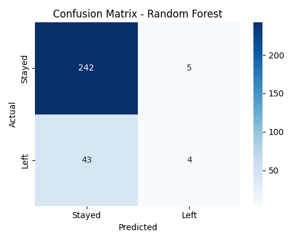
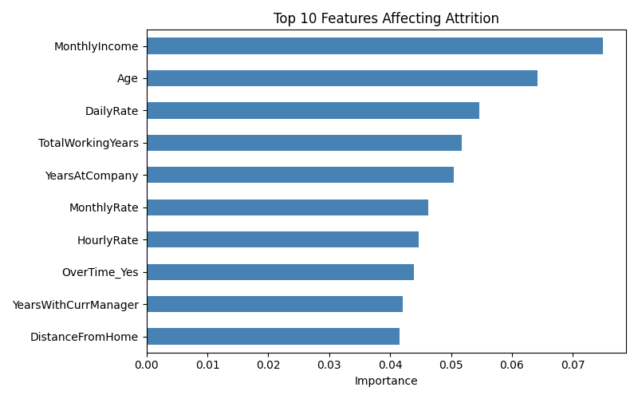
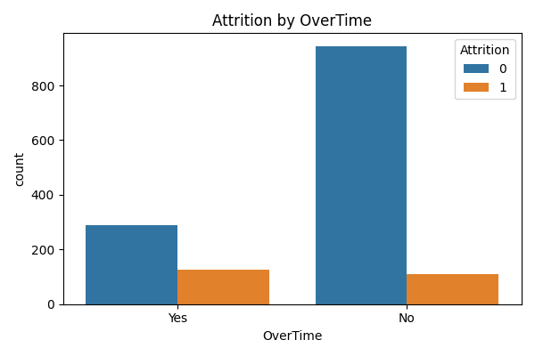

# 👔 Employee Attrition Predictor

Predicts whether an employee is likely to leave a company using
Logistic Regression and Random Forest.
Built as part of my AI/ML learning journey.

---

## 🛠️ Tech Stack
- Python
- Pandas, NumPy
- Scikit-learn
- Matplotlib, Seaborn

## 📊 What This Project Does
- Loads the IBM HR Analytics dataset (1,470 employees, 35 columns)
- Cleans data and encodes text columns
- Handles imbalanced data (only about 16% of employees left)
- Trains Logistic Regression and Random Forest models
- Compares models using Accuracy, Precision, Recall and F1 Score
- Shows a confusion matrix and the top features driving attrition

## 📈 Results

| Model | Accuracy | Precision | Recall | F1 Score |
|-------|----------|-----------|--------|----------|
| Logistic Regression | 0.75 | 0.35 | 0.62 | 0.44 |
| Random Forest | 0.84 | 0.44 | 0.09 | 0.14 |





## 💡 Key Findings
- Only about 16% of employees left, so the data is imbalanced and accuracy alone is misleading
- Random Forest has higher accuracy (0.84) but very low recall (0.09), so it misses most employees who leave
- Logistic Regression has a better F1 score (0.44) and catches 62% of leavers
- Employees who work overtime left far more often (30.5% vs 10.4%)
- Monthly income, age and total working years are among the most important features

## 🔮 Next Steps
- Tune Random Forest and adjust the decision threshold to improve recall
- Try cross validation and other models such as XGBoost

## 🚀 How to Run
```bash
pip install -r requirements.txt
jupyter notebook employee_attrition.ipynb
```

## 📁 Project Files
- `employee_attrition.ipynb` : full notebook with code, outputs and charts
- `WA_Fn-UseC_-HR-Employee-Attrition.csv` : dataset
- `requirements.txt` : libraries needed
- `*.png` : result charts

## 📚 Dataset
IBM HR Analytics Employee Attrition (Kaggle)

## 👤 Author
Shanti | Aspiring AI/ML Developer | Open to Work
